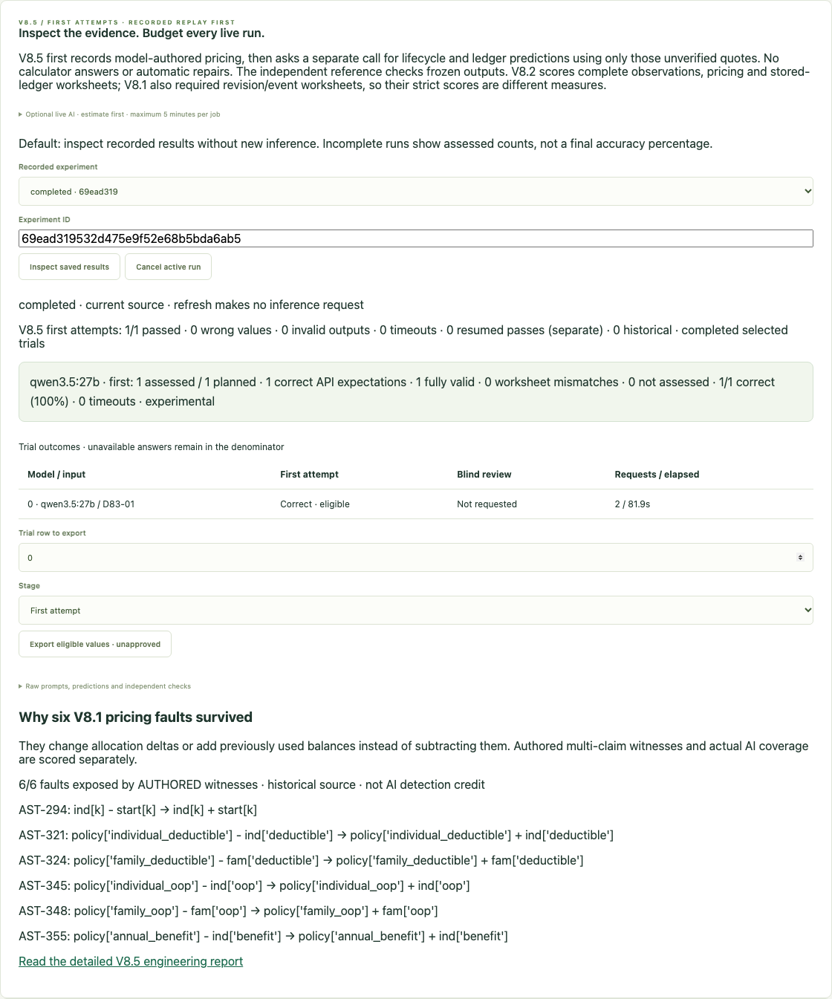
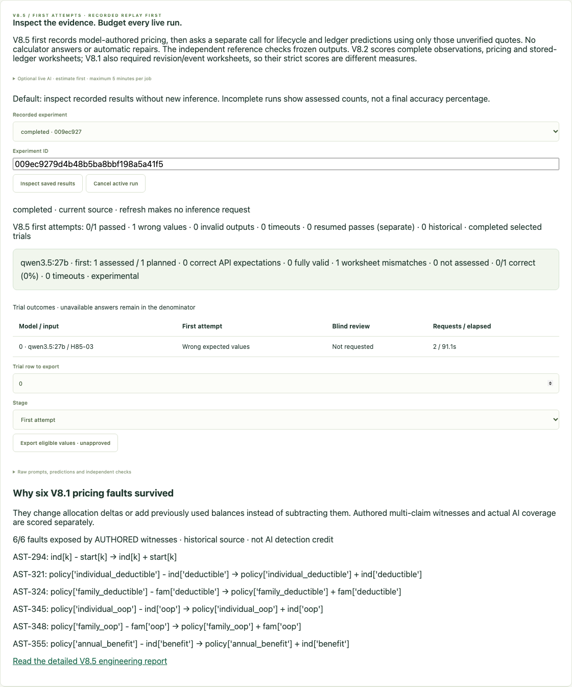
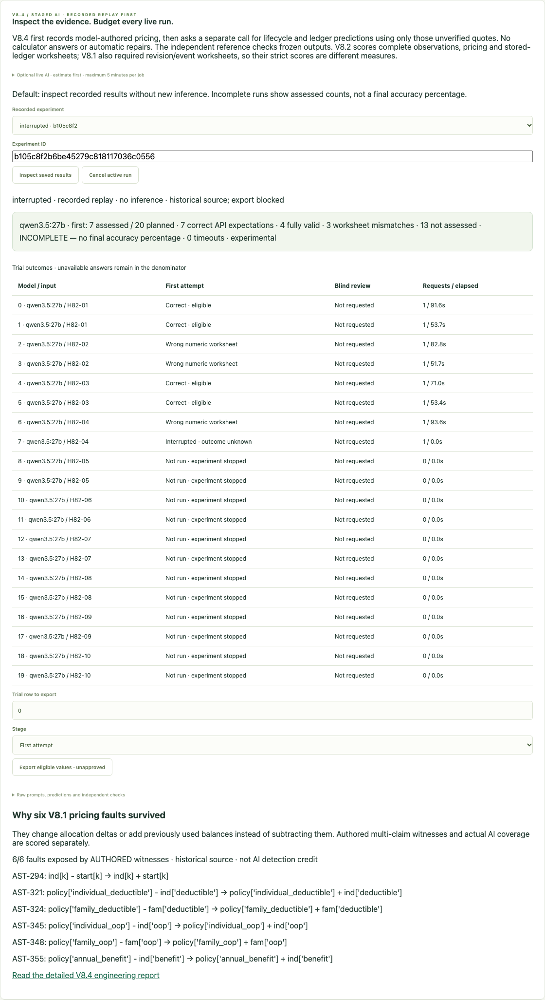
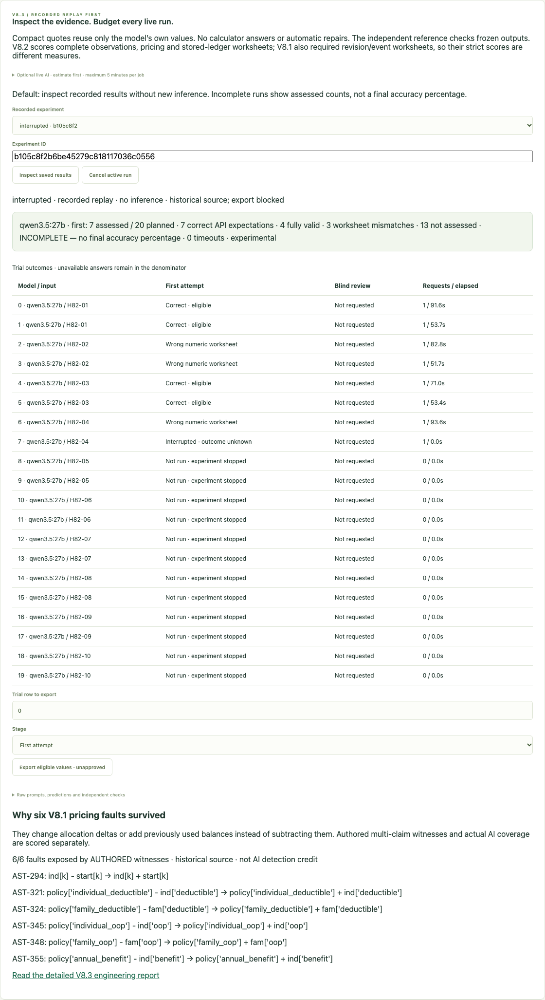
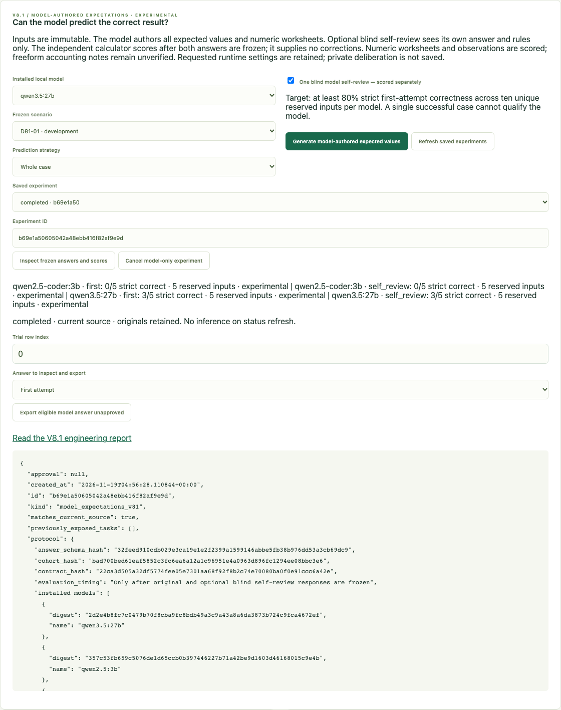
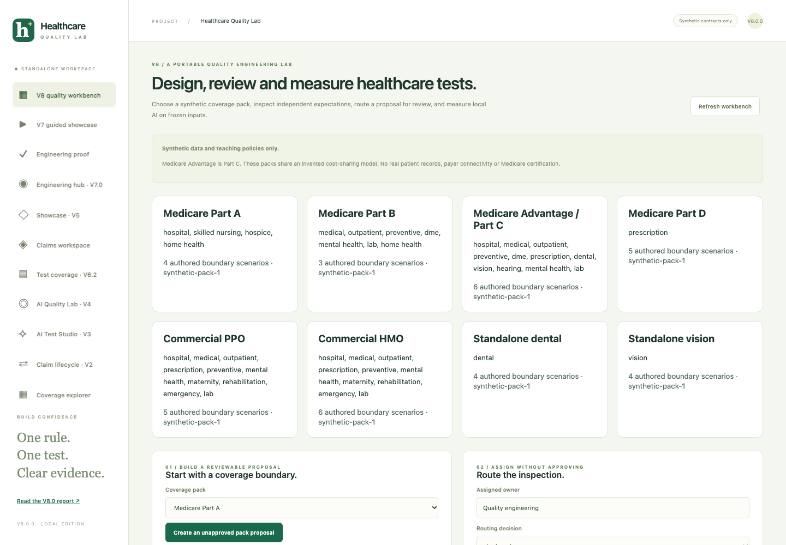
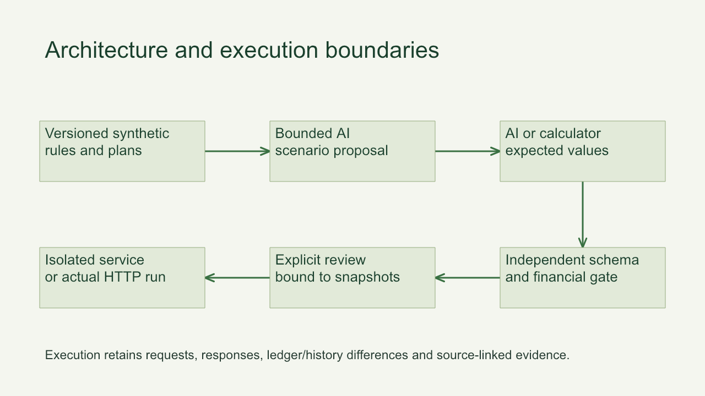
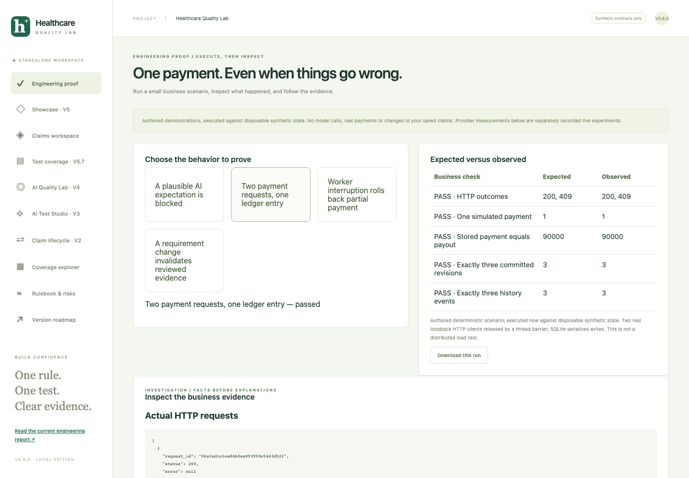
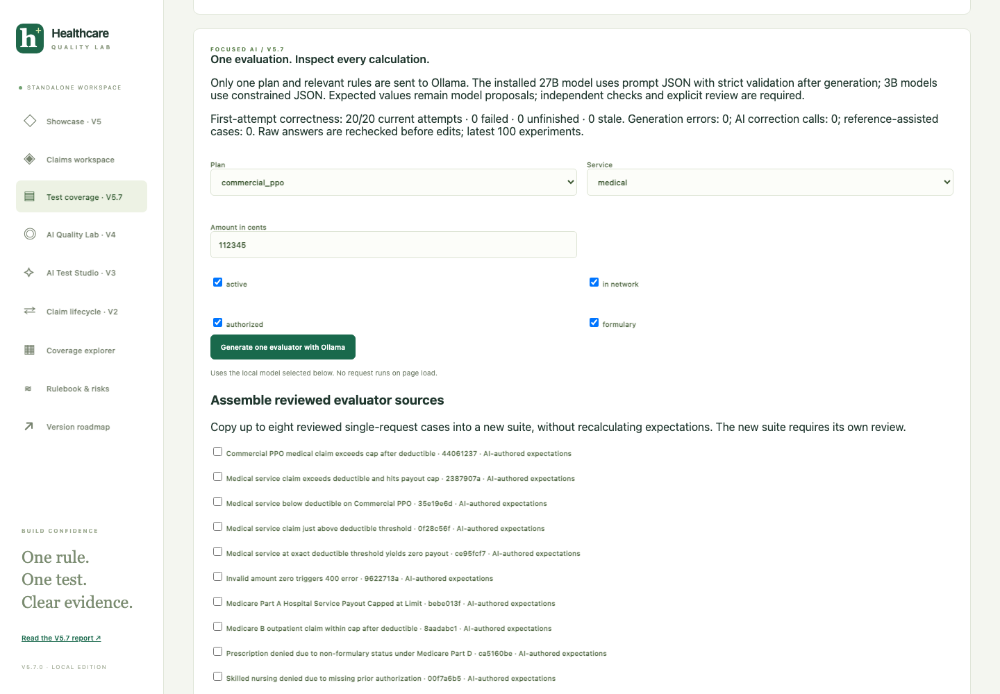
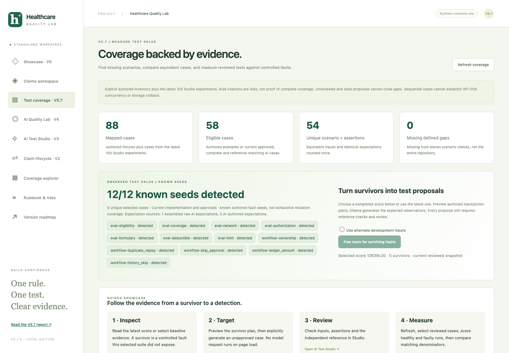

# Healthcare Quality Lab — V8.5

[Detailed report](docs/V8.5_REPORT.md) · [Printable report](docs/V8.5_REPORT.html) · [Operating guide](docs/V8.5_GUIDE.md) · [Frozen actual evaluation](artifacts/v8.5/assessment/evaluation-results.json)

V8.5 bounds redundant quotes, restricts lifecycle references to actual model quote IDs, separates stage facts/instructions, estimates each stage and requires an explicit budget. The scorecard distinguishes original passes from wrong values, timeouts, resumes and historical evidence.

**Actual first-attempt results:** the exposed original pilot and **1/3 fresh numeric variants** passed. All four cases completed using eight calls, with no timeout, retry, resume or numeric repair. Both passes were rejected-coverage/zero-payout cases; the nonzero pricing cases failed and stayed export-blocked. Two unchanged eligible cases passed actual HTTP after scripted engineering review. General model correctness remains experimental.

**Engineering acceptance:** 1,167/1,167 local and hosted standard checks, plus 264/264 full-browser checks without retry. Counts overlap. [GitHub Actions](https://github.com/kilicerdal/healthcare-quality-lab/actions/runs/45101000199).

```sh
.venv/bin/python -m tools.showcase_server start
.venv/bin/python -m tools.showcase_server status
.venv/bin/python -m tools.showcase_server stop
```

Open `http://127.0.0.1:8902/#workbench`. Replay makes no model call. All four actual trials are retained, including failures. Live V8.5 inference requires an explicit 1–300 second budget; calculators only check frozen predictions. All policies, identities and payments are synthetic.

The screenshot below selects the **exposed pilot only**; the complete fresh result is 1/3, not 100%.





# Archived V8.4 overview

[Detailed report](docs/V8.4_REPORT.md) · [Printable report](docs/V8.4_REPORT.html) · [Operating guide](docs/V8.4_GUIDE.md)

**Validation:** 1,124/1,124 local and hosted standard checks; 261/261 complete browser checks without retry. Totals overlap. [GitHub acceptance](https://github.com/kilicerdal/healthcare-quality-lab/actions/runs/45097315068).

V8.4 separates model pricing from lifecycle prediction, restores explicit rejected-line rules, records both stages, and replaces coverage Blob downloads with authenticated server-streamed JSON attachments. Unused quote aliases are normalized only when their complete values and worksheets exactly match a referenced quote; no expected number is changed.

**One resumed known AI pilot passed independent validation and actual HTTP with unchanged model values.** It required an explicit lifecycle continuation and exact-alias normalization. This is not first-attempt accuracy or model qualification: the small model passed 0/3, the initial larger comparison was incomplete, and all failures/timeouts remain recorded. Twelve actual model calls were made; no calculator supplied or repaired the model's numbers.

```sh
.venv/bin/python -m tools.showcase_server start
.venv/bin/python -m tools.showcase_server status
.venv/bin/python -m tools.showcase_server stop
```

Open `http://127.0.0.1:8902/#workbench`. Replay makes no model call. The existing state directory is preserved. Optional live jobs require an estimate and explicit budget. All policies, identities and payments are synthetic.



# Archived V8.3 overview

[Detailed V8.3 report](docs/V8.3_REPORT.md) · [Printable report](docs/V8.3_REPORT.html) · [Operating guide](docs/V8.3_GUIDE.md) · [Local verification](artifacts/v8.3/local-verification.json)

**Validation:** 1,104/1,104 local and hosted standard checks passed; the full browser matrix passed 261/261 on one unchanged-source rerun (87 per browser). The initial matrix had one legacy WebKit JSON-download timeout; the report retains it as an intermittent issue. Totals overlap. [GitHub acceptance](https://github.com/kilicerdal/healthcare-quality-lab/actions/runs/45092599846).

V8.3 adds replay-first evidence, explicit job time budgets and duration estimates, precise rejected-line/account-timing guidance, correct optional-review analysis and a state-preserving showcase launcher. The final browser-readiness fix prevents estimates before configuration loads and ignores stale estimate responses.

**AI expected values remain experimental.** The one new exposed small-model pilot took about twelve seconds and failed independent validation: **0/1 eligible**, blocked from export, no correction and no retry. This is not a qualification or an improved-accuracy claim. The original V8.2 partial run now clearly shows seven assessed of twenty planned, seven correct API observations, four fully valid predictions, three worksheet mismatches and thirteen not assessed—with no final accuracy percentage.

```sh
.venv/bin/python -m tools.showcase_server start
.venv/bin/python -m tools.showcase_server status
.venv/bin/python -m tools.showcase_server stop
```

Open `http://127.0.0.1:8902/#workbench`. Startup resumes saved state and requests no model inference. Optional live inference requires an estimate and a 1–300 second admitted-job budget (default 180). Backend cancellation is best effort; late answers cannot overwrite stopped jobs. All policies, identities and payments are synthetic.



# Archived V8.2 overview

[Detailed V8.2 report](docs/V8.2_REPORT.md) · [Operator guide](docs/V8.2_GUIDE.md) · [Architecture](docs/V8.2_ARCHITECTURE.md)

**Engineering acceptance: 1070/1070 local checks and 246/246 hosted full-browser checks passed. Totals overlap.** [Hosted acceptance](https://github.com/kilicerdal/healthcare-quality-lab/actions/runs/44474895811).

V8.2 adds compact model-authored quote reuse, explicit cap and stored-ledger worksheets, independent gates, readable failure categories and authored witnesses for all six prior surviving pricing faults. Those authored tests detect 27/27 trusted pricing mutations; they are not AI-generated coverage.

**AI qualification is INCOMPLETE.** The planned 20-trial run was stopped for timely delivery: 7 assessed, 4 eligible, 3 incorrect, 13 unfinished/unrun. No completed accuracy claim. Two unique unchanged eligible model cases passed actual HTTP through explicit manual engineering replay and detected 16/27 pricing mutations. The interrupted experiment remains export-blocked.

The final development 27B pilot passed 3/3 selected exposed cases. Vision and mixed-coverage failures remain. Calculators check frozen predictions; they never repair model values in this path.

Open the V8.2 showcase at `http://127.0.0.1:8902/#workbench`. All benefits, identities and payments are synthetic. VS Code was not opened; existing user stores and the unrelated V4 draft were preserved.

# Archived V8.1 overview

[Detailed V8.1 report](docs/V8.1_REPORT.md) · [Operator and AI learning guide](docs/V8.1_GUIDE.md) · [Architecture](docs/V8.1_ARCHITECTURE.md) · [Frozen actual model scorecard](artifacts/v8.1/heldout-scorecard.json)

**Engineering acceptance: 1021/1021 standard and 1175/1175 complete local three-browser checks passed.** Totals overlap. Hosted frozen-source complete E2E: [231/231](https://github.com/kilicerdal/healthcare-quality-lab/actions/runs/44461847829).

V8.1 adds experimental local Ollama expected-value generation: immutable claim inputs, model-authored monetary/state worksheets, optional blind self-review, durable experiments and separate review/HTTP execution. Independent calculators only check frozen answers; they never fill or correct the model's values in this path.

**Actual ten-input qualification:** qwen2.5-coder:3b: 0/10 strict first-attempt passes; qwen3.5:27b: 5/10 strict first-attempt passes. Blind self-review is scored separately. Zero reference-assisted corrections. The mode remains experimental; the report explains failed targets, wrong worksheets and the limits of this sample. The prior 0/16 remains historical evidence from a different cohort, not a matched before/after comparison.

**Actual execution:** 5 unique eligible unchanged model cases passed actual HTTP after scripted engineering inspection. Wrong answers remained blocked.

```sh
python3 -m tools.launch_demo --state-dir .local/v81-new-demo --port 8901
```

The already-running V8.1 showcase is at `http://127.0.0.1:8901/#workbench`, using fresh `.local/demo-v810` state. Load saved actual experiments without inference. All policies, identities and payments are synthetic.



# Archived V8.0 overview

[V8.0.0 release](https://github.com/kilicerdal/healthcare-quality-lab/releases/tag/v8.0.0) · [Observed hosted full acceptance](https://github.com/kilicerdal/healthcare-quality-lab/actions/runs/44454271666)

**Local acceptance: 968/968 standard checks and 1112/1112 complete three-browser checks passed.** Totals overlap. [Detailed ten-version delivery report](docs/V7.1_TO_V8.0_DELIVERY_REPORT.md) · [Operating and AI learning guide](docs/V8_GUIDE.md) · [Architecture](docs/V8_ARCHITECTURE.md) · [Adapter contract](docs/V8_ADAPTER_CONTRACT.md).

A standalone synthetic quality engineering lab: Python, Flask, SQLite, pytest, Playwright and optional local Ollama. V8 connects eight coverage packs, financial-readback gates, AI scenario design, a 31-input frozen evaluation cohort, evidence assistance, ownership routing, explicit review and actual HTTP execution.

```sh
python3 -m tools.launch_demo --state-dir .local/v8-new-demo --port 8899
```

Open `http://127.0.0.1:8899/#workbench`. Existing state is never reset; choose a fresh directory and unused port. Run `python -m tools.doctor` from the installed project environment for read-only diagnostics. See the guide for developer/browser setup and Windows interpreter paths.

**Honest AI result:** 0/16 raw expectation answers were eligible in the selected two-model/two-prompt repeated sample. The focused prompt did not improve strict correctness. Separately, one actual AI-designed Part B outpatient case with calculator-authored expectations passed actual HTTP and detected 19/27 pricing variants without reference-assisted correction. Calculator values are not model reasoning. [Original comparison](artifacts/v7.3/live-comparison.json) · [Actual AI plan and execution](artifacts/v7.8/live-ai-planner.json).

**Engineering result:** 44 authored coverage/lifecycle scenarios passed 88 executions across two HTTP targets. The second is a reference-backed sample, not an external payer. New authored journeys detected 22/27 pricing mutations; the disclosed authored union remains 27/27. Security, dependency and load receipts state their limits. All policies, identities and payments are synthetic.



[Actual captioned walkthrough](artifacts/v8.0/showcase-recording/healthcare-quality-lab-v8.webm) · [Captions](artifacts/v8.0/showcase-recording/healthcare-quality-lab-v8.vtt) · [Recording provenance](artifacts/v8.0/showcase-recording/capture.json). Five-second presentation holds aid reading; they are not application latency. No inference is made by the recording.

## V7.1–V8.0 detailed reports

| Milestone | Purpose | Report |
| --- | --- | --- |
| V7.1 | Installation | [Detailed report](docs/V7.1_REPORT.md) |
| V7.2 | Scenario quality | [Detailed report](docs/V7.2_REPORT.md) |
| V7.3 | Frozen AI evaluation | [Detailed report](docs/V7.3_REPORT.md) |
| V7.4 | Coverage packs | [Detailed report](docs/V7.4_REPORT.md) |
| V7.5 | Claim journeys | [Detailed report](docs/V7.5_REPORT.md) |
| V7.6 | HTTP adapters | [Detailed report](docs/V7.6_REPORT.md) |
| V7.7 | Security and resilience | [Detailed report](docs/V7.7_REPORT.md) |
| V7.8 | Governed assistance | [Detailed report](docs/V7.8_REPORT.md) |
| V7.9 | Team and evidence workflow | [Detailed report](docs/V7.9_REPORT.md) |
| V8.0 | Integrated showcase | [Detailed report](docs/V8.0_REPORT.md) |

# Archived V7.0 overview

[](https://github.com/kilicerdal/healthcare-quality-lab/actions/workflows/ci.yml)
  [](LICENSE)

**Archived V7.0 local checks:** 908/908 standard and 1046/1046 complete three-browser checks passed (overlapping totals). [Complete delivery report](docs/V6.8_TO_V7.0_DELIVERY_REPORT.md).

**Archived accepted release: V7.0.2.** Complete hosted sweeps exposed Studio and research-hub readiness races. Both fixes have deterministic held-response browser controls; the earlier unreleased tags remain preserved. [Captioned accepted recording](artifacts/v7.0/video-patch-two/healthcare-quality-lab-v7.webm).

**Review V7.0:** [Fresh-start guided demo](docs/V7.0_DEMO.md) · [Detailed final report](docs/V7.0_REPORT.md) · [Architecture](docs/V7.0_ARCHITECTURE.md) · [AI learning guide](docs/AI_LEARNING_GUIDE.md).

**Earlier review in five minutes:** [What to run, which failure to inspect, and what it proves](docs/REVIEWER_GUIDE.md) · [Evidence provenance](docs/EVIDENCE.md).

A quality engineering portfolio built with **Python, Flask, SQLite, pytest, Playwright, local Ollama and an explicit OpenAI evaluation CLI**.

The central question is simple: **does a test detect the wrong business result, or does it only pass?** This lab follows synthetic claims from evaluation through approval and payment, checks AI-created expectations against an independent reference model, and measures reviewed tests against known defects.

**Synthetic data only.** Plan amounts, demo identities and payments are invented. This is a local teaching application, not a real payer system or a compliance certification.

**Start here:** [Current advanced demo](docs/V6.7_DEMO.md) · [Earlier two-minute engineering demo](docs/V5.8_DEMO.md) · [Case study](docs/CASE_STUDY.md) · [Historical V5.7 guided demo](docs/V5.7_DEMO.md) · [Code examples](#review-the-code) · [Run locally](#run-locally)

**How this differs from [Healthcare Quality Platform](https://github.com/kilicerdal/ai-healthcare-quality-platform):** this lab focuses on business-rule correctness, independent checking of AI expectations, review gates, and payment concurrency/recovery. The platform focuses on API contracts, PostgreSQL persistence, and simulated S3/SQS message processing.

## V6.8–V7.0: design, investigate, trace and measure

Start a fresh local replay with `python3 -m tools.launch_demo --state-dir .local/v7-fresh --port 8897`, then open `http://127.0.0.1:8897/#journey`. The launcher refuses existing state and makes no model request.

| Milestone | Engineering purpose | Detailed report |
| --- | --- | --- |
| V6.8 | Separate AI planning, AI expectations and independent calculator authorship | [Report](docs/V6.8_REPORT.md) |
| V6.9 | Capture sealed failure evidence and score cited AI hypotheses | [Report](docs/V6.9_REPORT.md) |
| V6.10 | Link versioned requirements, scenarios, assertions and current executions | [Report](docs/V6.10_REPORT.md) |
| V6.11 | Measure actual pricing mutations, properties and failing-prefix reduction | [Report](docs/V6.11_REPORT.md) |
| V6.12 | Freeze model/prompt comparisons, budgets and original raw answers | [Report](docs/V6.12_REPORT.md) |
| V7.0 | Reproduce the connected workflow, inspect reports and verify the release | [Report](docs/V7.0_REPORT.md) |

**Observed AI limits:** the four raw model/prompt answers on one selected frozen XP-03 input were all ineligible; the focused prompt did not improve raw accuracy in that sample. Four calculator controls compiled without model calls. The actual small-model scenario from V6.8 passed independent checks with calculator-authored expectations. Original outputs, failures, digests and token/runtime metadata remain available.

**Observed test effectiveness:** original authored controls detected 25/27 pricing variants; two new authored boundaries bring their union to 27/27. The historical AI scenario with calculator values detected 19/27. Wrong raw AI has no score because its healthy baseline failed. Seeded property checks detected 14/27, with survivors retained. Different budgets prevent an equal-budget model ranking.

The release includes a captioned actual UI demonstration, public previews of an eight-slide presentation, six reports, source-linked verification and archived upgrade/rollback receipts. [Run and inspect the complete workflow](docs/V7.0_DEMO.md). A green model job is not proof of a correct answer, and calculator-generated values are not model reasoning.



## V6.3–V6.7: advanced AI cases and external-service recovery

The advanced Studio now accepts a separate bounded benefit DSL: payment, adjustment, reversal, appeal, resolution and readback, with full money/history/ledger/accumulator assertions. A separate lifecycle oracle checks proposals before explicit snapshot-bound review and actual isolated HTTP execution. The original Studio remains compatible.

The evaluation scorecard separates raw model answers from one reference-assisted correction, freezes business inputs, detects semantic duplicates and retains provider failures. Local-model CI uses an owner-dispatched one-job container runner with no host mounts. The external-service lab rehearses real loopback HTTP eligibility/payment faults, durable intent reconciliation, duplicate/stale webhooks and actual worker-exit recovery. All data and money are synthetic.

- Detailed reports: [V6.3](docs/V6.3_REPORT.md) · [V6.4](docs/V6.4_REPORT.md) · [V6.5](docs/V6.5_REPORT.md) · [V6.6](docs/V6.6_REPORT.md) · [V6.7](docs/V6.7_REPORT.md)
- [Reproduce the complete demonstration](docs/V6.7_DEMO.md), including explicit Ollama and ephemeral-runner commands.
- Verification, live model outcomes, video and exact CI/release provenance are attached as release evidence. Model-job completion is distinct from proposal eligibility; inspect failures as well as successes.

**Final local validation:** 813/813 standard checks; a separate complete 929/929 run across Chromium, Firefox and WebKit (overlapping totals). Nine HTTP integration scenarios passed, and the bounded pricing experiment detected 27/27 mutants. Current 27B ADV-05 measurement: 0/1 raw eligible, 1/1 after one actual reference-assisted correction. The repeated 3B comparison remained 0/4 raw and 0/4 assisted. These small samples are retained as evidence, not general model accuracy.

[Captioned V6.7 recording](artifacts/v6.6/healthcare-quality-lab-v6.7.webm) · [Captions](artifacts/v6.6/healthcare-quality-lab-v6.7.vtt) · [Recording provenance](artifacts/v6.6/capture.json)

## Prior V6.2 engineering evidence hub

V5.8–V6.2 additions are implemented locally: reserved repeated AI measurements, grounded investigation and rule traceability, effective-dated line benefits, family accumulators, coordination, appeals/adjustments/reversals, real HTTP execution, concurrency/rollback/property checks, authenticated-review mode, maintenance recommendations and a fresh replay launcher. The existing V5.8 proof page, provider spending controls, reports and maintenance work remain intact.

**Recorded V6.2 development validation:** 736 release-verification tests (591 unit, 93 API, 52 Chromium) and a separate overlapping 840-test Linux run with all browser tests in Chromium, Firefox and WebKit. Original known seeds: 12/12; bounded advanced-pricing AST mutations: 26/26. Live reserved evaluation: 8/8 strict correct for the installed 27B model and 0/8 for the 3B coding model on four inputs repeated twice; failures and limits remain visible.

**Publication:** the repository remains public as authorized. V6.2 hosted checks passed on its final commit; current release checks and exact commits are shown in GitHub Actions and the release receipts.

- [Complete V6.2 report](docs/V6.2_REPORT.md) and [guided demonstration](docs/V6.2_DEMO.md)
- [V5.8 reliability addendum](docs/V5.8_RELIABILITY_REPORT.md) · [V5.9 assistant](docs/V5.9_REPORT.md) · [V6.0 benefits](docs/V6.0_REPORT.md) · [V6.1 resilience](docs/V6.1_REPORT.md)
- [Extension architecture and operating guide](docs/V6.2_GUIDE.md)

One command from a fresh checkout with Python installed:

```sh
python3 -m tools.launch_demo --state-dir .local/demo-v67-fresh --port 8897
```

This creates project-local runtime dependencies and fresh labeled synthetic replay state. It never resets existing data, downloads models or calls a provider. Use an unused port for additional instances. The upstream `tools.demo` command below remains available unchanged.

## V5.8: inspect the engineering proof

Run competing payment requests, interrupt a worker before commit, investigate an incorrect expectation, and see a requirement change invalidate a review. Each authored scenario executes against disposable synthetic state, exposes expected/observed values and retains provenance. No model is called by the proof page.

```sh
python3 -m tools.bootstrap --browser
.venv/bin/python -m tools.demo --state-dir .local/demo-first-run --port 8895
```

Open [Engineering proof](http://127.0.0.1:8895/#proof). The launcher refuses nonempty directories and never resets your existing work. Historical experiment IDs are unnecessary.

[Recorded V5.8 engineering report](docs/V5.8_REPORT.md) · [Recorded V5.8 captioned walkthrough](https://github.com/kilicerdal/healthcare-quality-lab/releases/tag/v5.8.0) · [Observed authored scenario evidence](artifacts/showcase/deterministic-evidence.json)



*Recorded local V5.8 authored demonstration, November 17, 2026; not a live execution or provider result. [Source evidence and limits](docs/EVIDENCE.md).*

## Recorded V5.8 local provider comparison — November 17, 2026

Sixteen newly authored inputs, three trials each. Providers generate expectations and compact calculations inside an authored wrapper. Both receive the same base prompt/schema and synthetic rules; transport, decoding, hardware and model size differ.

| Provider | Literal expectations | Calculation records | Eligible for review | Median latency | API usage cost estimate |
| --- | --- | --- | --- | --- | --- |
| OpenAI GPT-6.1 Terra | 48/48 | 48/48 | 48/48 | 2.22 s | $0.04056 for the comparison |
| Local Ollama qwen3.5:27b | 48/48 | 42/48 | 42/48 | 9.75 s | Local hardware/electricity cost not measured |

Ollama's six blocked outputs had matching expected outcomes but incorrect or incomplete calculation records. Both providers repeated identical expectations across all sixteen inputs under the recorded settings. That does not establish stochastic robustness or general accuracy. All outputs remain unapproved; none was automatically executed.

The separate pilot plus comparison made 49 OpenAI requests: **$0.04218 usage-derived estimate**, with **$2.68744 conservatively reserved against the $15 cap**. These are different accounting measures, not an account billing invoice. No automatic retries or cloud fallback were used.

[Full trial evidence, failures, settings and budget](artifacts/showcase/provider-comparison.json) · [Evaluation commands and limits](docs/V5.8_DEMO.md)

## Results you can inspect

| Evidence | Recorded result | What it means |
| --- | --- | --- |
| Deterministic regression | **665 passed:** 538 unit, 81 API, 46 Chromium | Offline provider doubles; actual browser flows. [Recorded local verification, November 17, 2026](artifacts/verification.json) |
| Focused local AI generation | **20/20** correct first-attempt assertions/calculations | A frozen development cohort using local `qwen3.5:27b`; zero corrections or reference replacements. [Measurement](artifacts/v5.7/focused-measurement.json) |
| Reviewed AI-derived core suite | **12/12** known fault seeds detected | One original AI workflow plus an evaluator assembled from seven reviewed model outputs. Known seeds, not exhaustive defect coverage. [Report](docs/V5.7_REPORT.md) |
| Final guided showcase | **0 remaining gaps** among 11 defined scenario predicates | The four-case final suite closes this particular gap map. It does not establish complete application coverage. |

[Recorded GitHub Actions run](https://github.com/kilicerdal/healthcare-quality-lab/actions/runs/43314919548) passed on the previously recorded implementation fingerprint. Current checks appear in the [Actions tab](https://github.com/kilicerdal/healthcare-quality-lab/actions). Local model experiments and deterministic CI are separate evidence.



*Recorded V5.7 local experiment. These are observed development results, not a fresh model run or a blind benchmark.*



*Historical V5.7 local showcase; its gap map is bounded to eleven defined predicates. It is not the current CI result.*

## Review the code

| Example | Engineering decision |
| --- | --- |
| [Claim evaluator](healthcare_quality/claims.py) and [workflow](healthcare_quality/workflow.py) | Explicit business rules, persisted state, ownership checks, duplicate protection and ordered payment history |
| [Independent reference model](healthcare_quality/reference.py) | Expectations are calculated separately from the application under test |
| [AI review and execution](healthcare_quality/ai_studio.py) | Hash-bound approvals, fresh review after edits, isolated execution and retained provenance |
| [Coverage and defect scoring](healthcare_quality/coverage_lab.py) | Healthy controls first; assertion mismatches earn detection credit, infrastructure errors do not |
| [Operation recovery](healthcare_quality/operations.py) | Persisted heartbeat leases and fenced completion after interruption |
| [Unit tests](tests/unit), [API tests](tests/api), [browser tests](tests/e2e) | Different layers verify business behavior and the actual UI |
| [CI workflow](.github/workflows/ci.yml) and [release tooling](tools/release.py) | Regression, source integrity checks and a staged runtime rehearsal |

## Run locally

Requires **Python 3.11–3.13** for the documented hosted matrix; the recorded delivery used Python 3.13. [Runtime and test matrix](docs/MAINTENANCE.md). Newer Python versions are not yet verified.

```sh
git clone https://github.com/kilicerdal/healthcare-quality-lab.git
cd healthcare-quality-lab
python3 -m tools.bootstrap --browser
.venv/bin/python -m tools.serve --port 8895
```

Open [the local guided showcase](http://127.0.0.1:8895/#showcase). On Windows use `.venv\Scripts\python.exe` instead of `.venv/bin/python`.

Bootstrap installs project-local dependencies and Chromium. It does not install Ollama or download models. **The deterministic tests do not require a model or paid API credits.** Running actual AI generation is optional and requires your own local Ollama service and an allowed installed model.

```sh
.venv/bin/python -m tools.verify
.venv/bin/python -m pytest -m smoke -v
.venv/bin/python -m pytest -m e2e --headed --slowmo 350
```

## How AI cases become executable tests

1. Request bounded declarative proposals from local Ollama using selected written contracts.
2. Inspect inputs, assertions, retrieved sources and independent reference checks. Wrong or incomplete expectations block approval.
3. Explicitly review the snapshot. An edit, correction or reference replacement clears approval and requires fresh review.
4. Execute approved cases against disposable SQLite databases, then compare healthy behavior with known fault seeds.

The model has no shell, browser, database or arbitrary network tools. The case language permits only evaluate/submit/transition/read, with at most four cases and eight steps per case. Generated Python is not executed. Reviewer labels are local attestations, not authenticated human identities.

## Scope and limitations

- The 20-task AI result is a development demonstration. The model and prompt both changed from earlier pilots; the result cannot be attributed to prompting alone.
- Failed small-model pilots, incorrect drafts and surviving faults remain in the historical evidence.
- Twelve known seeds and eleven scenario predicates define the measured scope. They do not prove general model accuracy or complete defect detection.
- Demo actor headers and reviewer labels are not production authentication. Keep the runtime on loopback; do not expose it to the internet or enter real patient data.
- Public source availability does not mean a publicly hosted application. No production deployment, healthcare compliance or accessibility certification is claimed.

## Reports and release operations

Read the [V5.8 report](docs/V5.8_REPORT.md), [current demo](docs/V5.8_DEMO.md), [case study](docs/CASE_STUDY.md), [architecture](docs/ARCHITECTURE.md), [operations guide](docs/OPERATIONS.md) and [publication review](docs/PUBLICATION_REVIEW.md).

Historical reports: [V5.1](docs/V5.1_REPORT.md) · [V5.2](docs/V5.2_REPORT.md) · [V5.3](docs/V5.3_REPORT.md) · [V5.4](docs/V5.4_REPORT.md) · [V5.5](docs/V5.5_REPORT.md) · [V5.6](docs/V5.6_REPORT.md) · [V5.7](docs/V5.7_REPORT.md).

After fresh verification, build and inspect a source package:

```sh
.venv/bin/python -m tools.release build
.venv/bin/python -m tools.release inspect releases/v5.8.0-source.zip
```

The operations guide covers staging, activation and rollback. Packages exclude local databases, environments, browser binaries and caches. Checksums establish integrity, not a signed publisher identity.

## AI provenance

Codex built the implementation. Ollama performed the recorded local generation experiments. Optional ChatGPT, Copilot and Claude Code exercises are described in the [AI tools playbook](docs/AI_TOOLS_PLAYBOOK.md); they are not represented as integrations that ran.

## Contributing and maintenance

[Contributing](CONTRIBUTING.md) · [Security reporting](SECURITY.md) · [Dependency maintenance](docs/DEPENDENCY_MAINTENANCE.md).

## License

This project's original code is licensed under the [MIT License](LICENSE), copyright (c) 2026 Erdal Kilic. Third-party dependencies and separately attributed materials retain their own licenses.

## Compatibility and maintenance

[Supported versions, quick/full checks, dependency decisions and upgrade policy](docs/MAINTENANCE.md). Historical evidence stays dated; current CI status is linked above.
