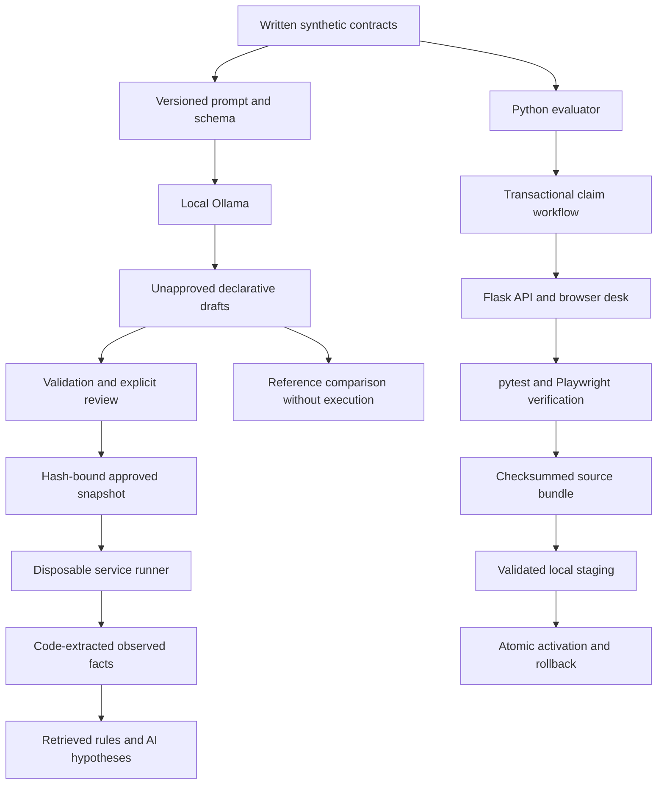

# Final architecture narrative

The system has three evidence paths sharing written synthetic contracts.

The evaluator checks invented eligibility/benefit/network/authorization/formulary/deductible/limit contracts. The workflow owns member identity, state transitions, event history and simulated ledger writes inside SQLite transactions.

Studio metadata is separate from claims. Raw proposals never become executable code. Review binds selected data hashes and the current contract fingerprint. Each approved case executes in a disposable database; the browser desk uses persistent synthetic state. The downloaded pytest wrapper is trusted application-authored code containing reviewed data.

V4 compares drafts to authored reference data without executing them. It freezes prompt/task inputs and keeps all raw results. Investigation extracts runner failures in code before any model call. Valid citation IDs do not prove an explanation is true.

V5 verifies implementation/configuration fingerprints, packages source and portable synthetic evidence, validates payload digests and paths, and stages isolated releases. Activation/rollback changes an atomic pointer, with state separated per release. Waitress serves the selected payload on loopback. There is no distributed queue, hot deployment or database migration. GitHub Actions verifies the same code on Ubuntu and rehearses the newly built package over actual HTTP.

All five versions are learning milestones in one independent project. Earlier archives preserve earlier implementations; the current checkout contains V5. Public healthcare eligibility, real claims processing, patient data, external payments and production access control remain outside the system.
