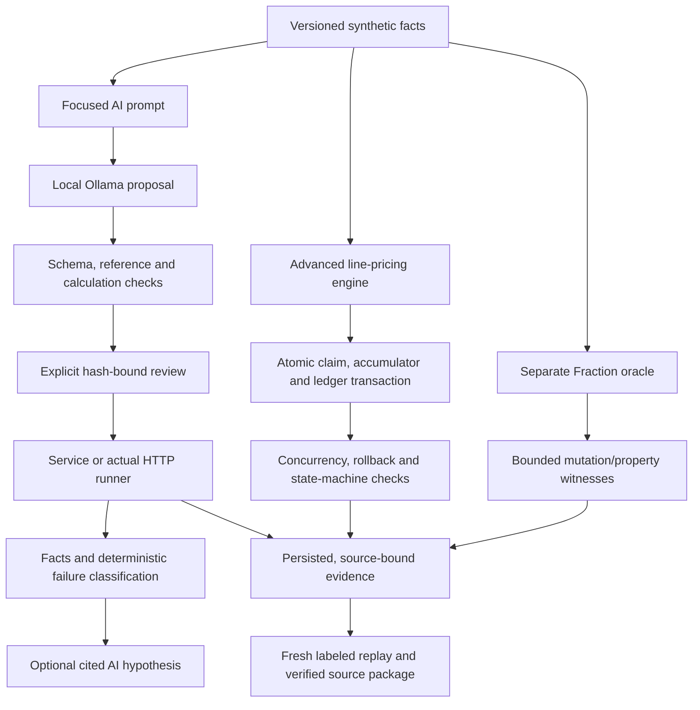

# V6.2 extension architecture and operating guide

## Boundaries

The legacy evaluator/workflow and its AI DSL retain their written contracts. Advanced benefits are a distinct engine and store. They share synthetic plan/service facts but do not share the same payout formula. Effective policies are frozen into new advanced claims, and stored amounts are not recomputed on reads.



## Main APIs

| Endpoint | Purpose |
| --- | --- |
| GET /api/research/overview | Read batch summaries, model/task choices and saved investigations |
| POST /api/research/benchmarks | Explicit bounded repeated local evaluation |
| POST /api/research/benchmarks/ID/cancel | Cancel and fence late completion |
| GET /api/research/benchmarks/ID | Inspect complete frozen/raw measurement |
| POST /api/research/investigations | Classify a stored run; optional local hypotheses |
| POST /api/research/changes | Inspect citation-based rule impact |
| POST /api/research/changes/propose | Generate a separate unapproved legacy-DSL proposal |
| GET /api/research/suite/ID | Recommend an observed seed-preserving suite |
| GET /api/research/maintenance/ID | Compare matching execution outcomes |
| GET /api/benefits/catalog | Read explicit synthetic policy and BN rules |
| POST /api/benefits/claims | Adjudicate and reserve synthetic line allocations |
| POST /api/benefits/claims/ID/ACTION | pay, adjust, reverse, appeal or resolve |
| GET /api/benefits/claims/ID | Read policy, lines, accumulators, events and ledger |
| GET /api/auth/session | Inspect local/shared mode and current session |
| POST /api/auth/login or logout | Shared-lab session lifecycle |
| GET /api/auth/audit | Verify the audit hash chain; auditor/admin in shared mode |

All model and financial writes require explicit requests. Page load reads only. No endpoint accepts generated Python or arbitrary network targets. The optional OpenAI evaluation CLI and spending controls from upstream remain unchanged; the new reliability hub uses the local-model allowlist.

## Optional configured-account mode

Local mode is the default and remains loopback-only. No account, password or secret was created automatically. To configure a separate shared-lab instance, use the interactive password-hash tool, keep its file under .local, and supply a random session secret through the environment. Do not commit those values.

```sh
.venv/bin/python -m tools.identities --file .local/identities.json --username reviewer --roles reviewer auditor --actor auditor-demo
```

The tool prompts for a password twice and writes only its hash with restrictive file permissions. Set HQL_IDENTITIES_FILE to that file and HQL_SESSION_SECRET to a securely generated value of at least 32 characters, then launch tools.serve with fresh state and a free port. The secret must not be printed into reports or source. Shared mode refuses startup if required configuration is missing.

Login returns a CSRF token for mutating API calls. The hub handles it for its browser session. The server supplies reviewer identity and rejects actor-header spoofing. Audit records omit bodies/passwords/query strings. Account provisioning, reset/SSO screens, external immutable audit anchoring and production TLS deployment are outside this local-lab delivery.

## CI and local validation

The main workflow defines fast PR checks, full package verification, additional browsers and scheduled/manual full-browser runs. The upstream Python compatibility matrix is preserved. The live-AI workflow is workflow_dispatch only, requires an intentionally configured self-hosted hql-ollama runner and never pulls a model automatically. It has not been reported as executed.

Mac browser-driver failures were diagnosed with short probes. A temporary isolated Colima profile and Docker configuration were used for Linux validation, without activating another global Docker context or mounting other projects. The Linux image matched project dependency pins and installed matching browsers. See the official [Playwright container guidance](https://playwright.dev/python/docs/docker) and [Colima configuration guidance](https://github.com/abiosoft/colima/blob/main/docs/FAQ.md). A minimal-image libatomic dependency and normal Linux font-metric difference were corrected in the validation environment/contracts; assertions were not bypassed with forced clicks.

Full receipts overlap: 736 release-verification tests and 840 tests when the complete browser suite runs in three engines. Do not add them together as independent cases. The known twelve-seed score and bounded 26-mutant sweep are separate experiments.

## Release and data safety

Backups of the original four stores are in .local/backup-before-v62. The final audit compares original row digests, not only counts. The preexisting V4 report edit remains unchanged and is not included as a new published change. Source bundles exclude environments, browser binaries, state, caches and credentials. The package uses the committed historical V4 document in place of that local draft.

Use a fresh deployment target for candidate staging/rehearsal. Activation/rollback takes effect after a server restart and keeps release state separate; this is not a database migration or hot swap. Keep all earlier archives immutable. The current repository is public; publishing the new local extension is awaiting explicit authorization because the originating chat requested private delivery.
