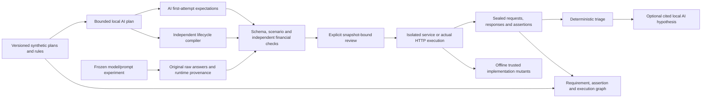

# V7.0 architecture and engineering boundaries

The model emits data in a restricted language, never Python, arbitrary URLs or shell actions. AI and compiler expectation authorship are separate. Both independently checked proposal paths require review before Studio execution.

The lifecycle reference is separate from the application claim service and production pricing function. They share written synthetic facts, so a common mistaken fact can affect both. Literal anchors and metamorphic properties add different checks; none establishes real insurer correctness.

Fault rehearsals and production mutation comparisons execute in isolated processes/stores. The interactive web server can read saved mutation evidence but cannot patch its production pricing dependency. Synthetic external eligibility/payment services have their own durable stores and reconciliation boundaries.

Durable design and experiment jobs use renewable leases and completion fencing. Raw answers are saved before assessment or subsequent requests. Cancellation cannot turn an in-flight unknown into a false provider failure or let a late response overwrite the record.

All new APIs remain under the advanced shared-auth/role/CSRF boundary. New stores are checked by readiness. Local reviewer labels and scripted demo attestations are explicitly distinguished from authenticated humans.

Historical evidence retains its original fingerprint. Current verification and approval require the current source/contract/case snapshots. Reports, traces, video and public release assets provide inspectable evidence; checksums are integrity metadata, not digital publisher signatures.
