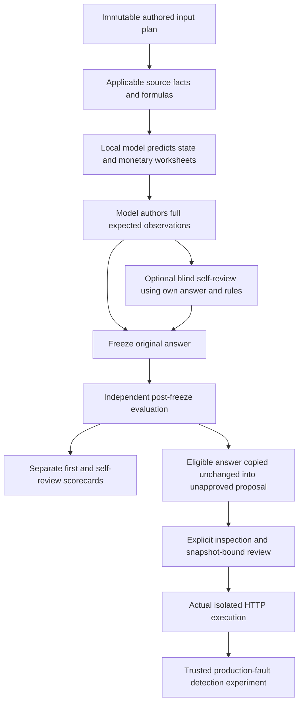

# V8.1 model-only expectation architecture

There is no feedback edge from the evaluator or application to either model stage. For stepwise mode, earlier model predictions are supplied as unverified context; observed application or oracle states are never substituted.

`expectation_protocol.py` constructs prompts and schemas from raw source facts. `expectation_lab.py` owns bounded local requests, leases, original outputs, blind review and scoring order. `expectation_evaluator.py` loads the independent oracle only after responses freeze. `expectation_api.py` enforces current-source export and creates an unapproved proposal. `expectations.js` displays original evidence as text and never starts inference on load.

`expectations-v81.sqlite` lives next to the configured claims database and is included in readiness. Tests and experiments use explicitly separate state; existing stores are not reset. The shared-lab authentication/CSRF boundary covers all new advanced endpoints. Native model reasoning is an explicit experimental CLI option; the locked main benchmark uses the bounded direct profile.

The source, cohort, requested profile/settings, selected model digests, per-request prompts/schemas and answer hashes are recorded. Duplicate or mixed-protocol aggregation is rejected. A source change during inference stops completion; frozen answers are not rewritten to match the new implementation.
