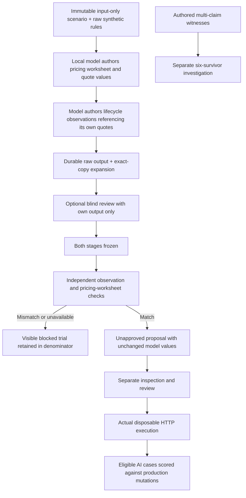

# V8.2 architecture and trust boundaries

`compact_expectations.py` owns raw-fact prompts, portable compact schema, reference resolution and immutable input assembly. It imports no evaluator and invokes no pricing function. Alias expansion is copying, not monetary calculation.

`expectation_lab.py` remains the durable shared engine. Its default protocol preserves V8.1 behavior; V8.2 injects its own cohort/protocol and evaluator. Both retain leases, cancellation, source fences, exposure history, raw responses, request budgets and separate original/review scores.

`compact_evaluator.py` checks complete expected observations and pricing-action worksheets only after responses freeze. The reference never supplies a model prediction or correction. `compact_api.py` uses a separate V8.2 store and inherits the existing advanced-route role/CSRF boundaries.

`CompactExpectationProvider` has a separate token/context/timeout profile; it leaves V8.1/legacy settings unchanged. `compact-expectations.js` renders readable metrics and trial categories using text nodes, with raw details collapsed and explicit inference controls.

`fault_audit_v82.py` applies trusted project-owned AST variants to authored multi-claim witnesses. Its metrics are deliberately separate from actual AI-case coverage. Read-only dashboard requests consume saved evidence and make zero model/mutation executions.
