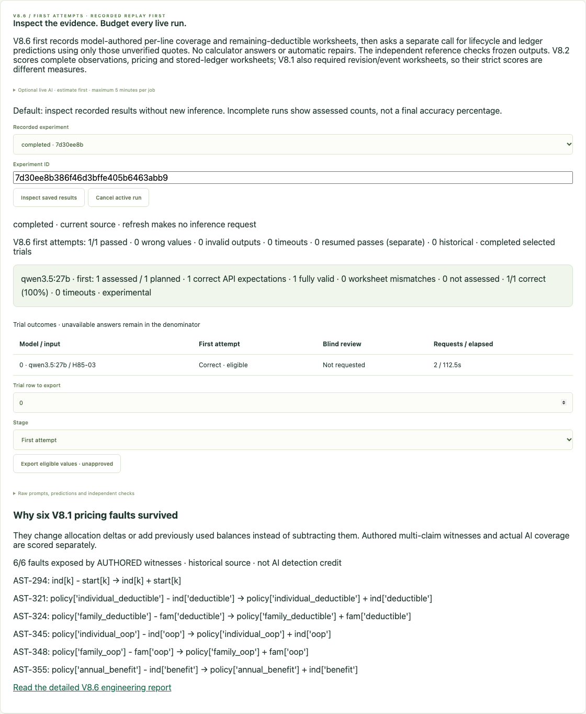
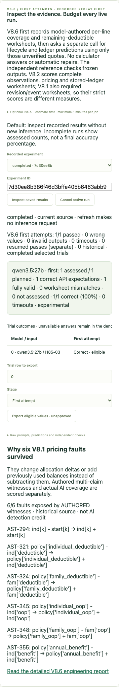

# Healthcare Quality Lab V8.6 Engineering Report

## Purpose and scope

V8.6 targets the two V8.5 failures: hospital and mixed medical/dental coverage. Both completed without a resume, but the model treated the entire eligible amount as nominal deductible and propagated that mistake into account, payout and ledger expectations. The mixed case also gave nonzero worksheet amounts to a rejected dental line.

The project is the standalone repository `/Users/erdalkilic/Documents/Healthcare Quality Lab`, on `codex/v86-deductible-first-attempts`. VS Code was not opened. Other projects and the unrelated V4 draft are outside this change. Policies, claims, identities and payments remain synthetic; this is an engineering showcase/research framework, not actual Medicare/commercial-policy compliance certification.

The objective is correct original model predictions under the fixed budget. The model must author the numbers. Reference calculators may independently check frozen answers afterward; they must not fill, correct or supply the expected values used by generation. The completed results below distinguish model accuracy from engineering acceptance.

## Explicit deductible and coverage worksheets

The new `deductible_expectations.py` protocol adds three required per-line fields: coverage_decision, individual_deductible_remaining_cents and family_deductible_remaining_cents. They appear before eligible money and nominal deductible in the generation schema. The model must explicitly identify coverage and write the two remaining balances before it chooses cost sharing.

The deductible equations are precise: each remaining balance is max(0, policy limit minus cumulative used balance immediately before the line). On a covered line nominal deductible is min(eligible, remaining individual deductible, remaining family deductible). It cannot exceed either emitted remaining balance. Copay, floor coinsurance, OOP clipping, benefit clipping and allocation updates follow in order.

On a rejected line, deductible, copay, coinsurance base, preliminary payer, pre-OOP member amount, capped member amount, post-OOP payer, final member and payout are zero. Noncovered money is eligible money. Account usage is unchanged. Remaining fields still describe the actual balances before that line, including changes caused by earlier covered lines. A rejected line cannot reset accounts to policy limits or inherit a covered line's financial formula.

These are general rules rather than correct numbers for a particular hospital or mixed case. No known payout, nominal deductible answer or reference worksheet is inserted into the model prompt. Structural quote bounds and lifecycle-ID restrictions from V8.5 remain in place, so one unchanged single-claim financial snapshot still needs only one quote.

## Distinguishing limits from usage

The model's policy inputs now use names such as individual_deductible_limit_cents, family_deductible_limit_cents, individual_oop_limit_cents, family_oop_limit_cents and annual_benefit_limit_cents. Copay is labeled copay_cents. Financial observation fields retain their established API names and mean cumulative used balances.

This renaming copies each existing raw fact without arithmetic. It does not calculate a remainder or derive a correct expected value. Explicit naming reduces confusion between a policy limit and a similarly named account output. Immutable claim inputs, policy dates, rates and numeric values are unchanged. Tests replace oracle/pricing functions with failures and confirm prompt/schema construction needs none of them.

Each attempt still has a pricing call and a separate lifecycle call containing only the model's own unverified quotes and action metadata. No evaluator feedback passes between stages. Existing admission-time budgets, clipped transport timeouts, durable phase metadata and late-output fencing remain intact. Backend cancellation is best effort, and the worker's generation lock remains held until it returns.

## Stronger independent checks without repairs

The new `deductible_evaluator.py` runs after model responses are frozen. It independently computes coverage decisions and remaining deductible balances using the reference claim/account history and Fraction-based benefit reference. It handles current member/family/year usage, prior lines and undoing only the original allocation before adjustment or appeal resolution.

The existing evaluator still checks every original monetary, account, lifecycle and stored-ledger expectation. A projection removes only the three new fields when delegating to the unchanged legacy checker; the new checker independently validates those three fields separately. No expected value is replaced. Eligibility requires both sets of checks to pass, and the stored answer hash covers the full extended answer.

Parsing validates all required new fields, preserves their exact model-authored values and copies the model's quote fields into observations. Unused-alias normalization compares the complete worksheet, including the new fields. Different coverage decisions or deductible remainders cannot be silently discarded as if they were identical aliases.

The negative controls are important: a correct API response with a wrong new worksheet field is rejected; an old wrong payout with correct auxiliary fields is still rejected; missing auxiliary fields are not filled in. The previous failed V8.5 artifacts remain unchanged rather than being relabeled as new passes.

## Bounded development before fresh assessment

The exposed hospital H85-02 and mixed-coverage H85-03 inputs are retained exactly as development regressions. H86-01 and H86-02 are new numeric variants of those scenario families. Previously published H85 inputs are historical. The fresh inputs contain no expected answers, and their reference solutions are not constructed for prompt generation.

The sealed runner first attempts both exposed cases. Complete wrong answers allow both known failures to be diagnosed, but any exposed failure prevents fresh generation. A timeout or provider error stops further work to avoid adding requests behind an uncertain backend operation.

The declared policy permits at most two candidates: one generic development revision may be made after exposed-case failure and before any fresh inference. All candidate plans, raw answers, outcomes and source identities remain separate. There is no result-based prompt change during the fresh assessment. Each case gets one original pricing/lifecycle pair, with no retry, resume, self-review, model switch, numeric repair or budget extension.

A candidate permits eight calls, 180 admitted seconds per case and a 600-second admission window, with full-case/preflight headroom required before another case starts. Across the permitted development candidates the ceiling is twelve actual model calls: a failed development candidate uses at most four before fresh assessment is stopped, and a final candidate can use eight. Unattempted cases remain visible and no final fresh percentage is reported for an incomplete assessment.

Source/cohort hashes, model identities/settings and request budgets are checked. Local full regression completes before model inference to avoid competing local browser processes. Hosted CI runs independently. Observed timings are not controlled causal model-performance benchmarks.

## Engineering verification and preservation

Focused checks cover all historical fixture shapes, full model-value preservation, wrong coverage/remainder rejection, missing-field rejection, alias differences, sequential balances after a covered line, oracle-free prompt construction and both exposed-case gating paths. Repricing fixtures verify adjustment and appeal-resolution restore the original deductible allocation before replacement pricing. Two initial fixture failures came from omitted required operation notes; those fixtures were corrected before any model experiment or source freeze. The production schema was not weakened.

The complete standard suite covers unit/API/Chromium journeys and known evaluator/workflow faults. Hosted validation covers Firefox, WebKit, the complete three-browser E2E matrix, pricing mutation checks, resilience, integrations, portfolio checks and release build/inspection/rehearsal. Counts overlap and must not be added as unique tests. Core provider fixtures are offline engineering checks, not actual AI accuracy evidence.

V8.6 has a separate API/store/readiness entry; older protocols and stores remain available. Explicit 1–300 second operator budgets and stage/shape timing estimates are retained. The current scorecard distinguishes original passes, wrong values, invalid output, timeouts, resumed results and historical evidence.

Eligible actual cases must pass the normal public export gate. Export creates an unapproved proposal; execution is blocked until review. Actual HTTP replay uses unchanged model values and isolated synthetic state. Scripted engineering inspection is not independent human review. Incorrect or interrupted predictions remain blocked.

Raw model evidence, input-only plans and source-specific receipts are stored under `artifacts/v8.6/`. Existing rows, earlier raw artifacts and the V4 draft are checked for preservation. Older screenshots regenerated by regression are restored. Private state/logs are not published. Development-branch delivery does not promote main or create a release tag.

## Operating the result and limits

See `docs/V8.6_GUIDE.md` for replay startup, explicit inference, the gated sealed exercise and evidence interpretation. The existing showcase state directory is retained. Startup and saved replay make no generation call.

Both known nonzero hospital and mixed cases now pass on the first attempt, together with two fresh numeric variants. This is a small sample, not broad generalization or ten-input model qualification. The published variants are now exposed; future reruns must not describe them as fresh.

## Completed AI results

One frozen implementation candidate was sufficient. The installed qwen3.5:27b model used temperature 0 and seed 7, with the existing direct profile. Each case made exactly one pricing call and one lifecycle call. Eight actual calls were used out of the predeclared twelve-call development ceiling. No second candidate, retry, resume, self-review, model switch, budget extension, numerical repair or alias pruning was used. The sealed exercise took 394.41 seconds.

| Case | Assessment role | First attempt | Model payout (cents) |
| --- | --- | --- | ---: |
| H85-02 hospital | Previously exposed failure | Passed | 52312 |
| H85-03 mixed medical/dental | Previously exposed failure | Passed | 34984 |
| H86-01 hospital | Fresh numeric variant | Passed | 45938 |
| H86-02 mixed medical/dental | Fresh numeric variant | Passed | 37853 |

The result is **2/2 known regressions fixed and 2/2 fresh variants passed**, or 4/4 strict original passes. All cases have positive payouts. The protocol/source remained stable throughout; the ten-fresh-input qualification threshold is not met. This demonstrates the requested cases and nearby numeric variants, not universal healthcare-model reliability.

### What changed in the actual predictions

| Model-authored value | V8.5 wrong answer | V8.6 original answer |
| --- | ---: | ---: |
| Hospital nominal deductible | 76391 | 10000 |
| Hospital copay | 0 | 1000 |
| Hospital payout | 46391 | 52312 |
| Hospital member amount | 30000 | 24079 |
| Mixed covered-line nominal deductible | 54731 | 10000 |
| Mixed payout | 24731 | 34984 |
| Mixed covered-line member amount | 30000 | 19747 |
| Rejected dental pre-OOP member amount | 6193 | 0 |
| Rejected dental post-OOP payer amount | 6193 | 0 |

The hospital worksheet correctly reports 10000 individual and 20000 family deductible remaining before pricing. After the covered medical line, the rejected dental line correctly reports 0 individual and 10000 family remaining, while its cost-sharing fields stay zero. These are observations from the completed study, not answers supplied in the generation prompt.

## Actual execution and engineering acceptance

All four unchanged model records passed independent evaluation and the normal public proposal endpoint. Each proposal returned 201, remained unapproved, and execution correctly returned 409 before review. After explicitly scripted engineering review, all four passed actual HTTP execution. The exported expectations equal the model observations and original raw-file hashes remained unchanged. No independent human review is claimed.

- Focused pre-freeze checks: **55 passed**.
- Complete local standard suite: **1204/1204**, zero failures/skips, including 88 Chromium E2E checks; 218.94 seconds.
- Hosted standard suite: **1204/1204**.
- Hosted complete browser matrix: **264/264**, 88 each Chromium/Firefox/WebKit, zero failures/skips, no retry.
- Evaluator and workflow fault seeds: **7/7 and 5/5** detected.
- Hosted authored pricing mutation benchmark: **27/27** detected. This is engineering coverage, not a claim that the four AI cases caught all mutations.
- Release build/inspection and actual HTTP rehearsal passed for 8.6.0. The receipt has rollback_verified=false; this version does not claim a new actual rollback demonstration.

These suite counts overlap and must not be added as unique tests. [Quality and browser Actions run](https://github.com/kilicerdal/healthcare-quality-lab/actions/runs/45105779780) and [portable Actions run](https://github.com/kilicerdal/healthcare-quality-lab/actions/runs/45105779961) both passed on the frozen implementation commit bff3aec65b40b092cd028fba0a86c5dc7ab2f1cf. Source fingerprint: 32a9bec288e068a768f9383e7dab0cf73a7289a49ca6166e3ff5bd562479e63a. The final documentation/evidence commit does not change implementation; it shares that tested fingerprint.

## Showcase and delivery

The existing dashboard runs at http://127.0.0.1:8902/#workbench. V8.6 records are saved for replay without inference. Desktop and mobile screenshots show selected records; their 1/1 indicator describes the selected case, while the complete study is the separate 4/4 result above.

The delivery is scoped to codex/v86-deductible-first-attempts. Main, tags and releases are not promoted. Original synthetic database rows, earlier raw evidence and the unrelated V4 draft are preserved, with receipts in artifacts/v8.6/preservation.json and model-evidence-integrity.json. Private databases/logs remain local. VS Code was not opened.

We achieved the requested first-attempt fixes by making the model explicitly distinguish limits, usage, remaining deductible and rejected coverage, then independently checking every old and new field. The framework now provides stronger inspectable model reasoning and actual execution evidence without substituting calculator answers for model predictions. Broader unseen scenarios and independent human review remain future validation work.
