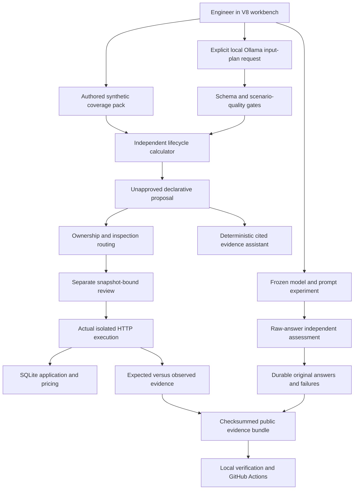

# V8 architecture and evidence boundaries

The expected values do not come from the system under test. The AI model has no approval or arbitrary execution authority. The reference-peer HTTP adapter uses the same independent oracle as expectation construction; it tests portability, not independent oracle correctness. The deterministic assistant describes saved facts; the separate Ollama planner creates scenario inputs. Raw AI expectation accuracy is measured separately from calculator-backed scenario usefulness.

## New persistence

`team-v8.sqlite` stores snapshot-bound routing decisions. `experiments-v8.sqlite` stores frozen expanded-cohort experiments and exposure. Both live next to the configured claims database and are checked by readiness. Existing stores and historical records are preserved. Tests, recording and rehearsals use disposable state. New demo instances use a fresh explicitly named directory.

## Test responsibilities

| Layer | Purpose | Provider access |
| --- | --- | --- |
| Unit | Rules, schema, quality, split isolation, budgets, snapshots, tampering controls | Offline doubles |
| API | Request validation, authorization/CSRF, routing versus approval, quality-gated export | Offline except explicitly selected live tools |
| Browser | Initialization gating, phone/desktop layout, actual workbench and separate review flow | No automatic inference |
| HTTP rehearsal | All pack/lifecycle inputs against both installed targets and a complete reviewed workflow | No inference |
| Resilience | Competing payments, restart, transaction rollback, bounded concurrent reads | No inference |
| Local AI comparison | One-attempt original answers, repeated trials, source/model/prompt provenance | Explicit installed Ollama calls |
| Release | Source checksums, staged execution, rollback, evidence package integrity | No paid calls |

## Known boundaries

The default runtime is loopback and synthetic. Shared mode is an existing optional authenticated lab configuration, not enterprise identity management. Real patient data, real benefits policy, EDI interoperability, payer connectivity, production capacity and compliance certification are outside the delivered scope. Optional ChatGPT, Copilot and Claude Code exercises are documented, not falsely counted as tools actually invoked.
